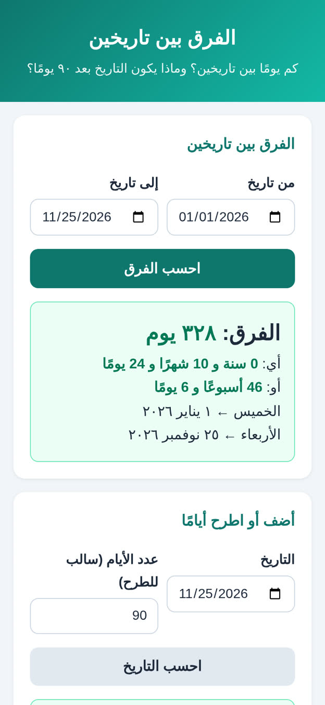

# Date Difference Calculator | الفرق بين تاريخين

Count the days, weeks and months between two dates, see the weekday of each, and add or subtract days from any date. Arabic interface.

**Live app:** https://abood-ayman.github.io/date-diff-calculator-ar/

**LinkedIn:** [Project entry](https://www.linkedin.com/in/abdullah-ayman-1678b737b/details/projects/)

This is a personal project, built with AI tools.

## Features
- Difference in total days, weeks, and years/months/days
- Weekday of each date you pick
- Add or subtract days from a date (useful for contracts and deadlines)

## Privacy
Everything runs in your browser. No data is stored or sent anywhere.

## Run locally
Open `index.html` in any browser. It is a single static page with no dependencies.

## Status
Stable.

## Copyright
MIT License - Copyright (c) 2026 Abdullah Ayman.
